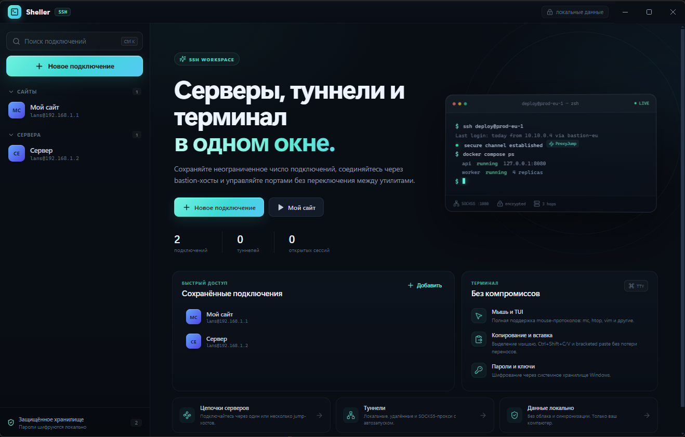

# Sheller

> Современный SSH-, Mosh- и Telnet-клиент для Windows с терминалом, SFTP и мониторингом сервера.

**Sheller** объединяет интерактивный терминал, файловый менеджер, проброс портов, jump-хосты и прокси в одном приложении. Пароли и ключи защищены средствами ОС, а мониторинг нагрузки работает без установки агента на сервер.

<div align="center">
  
  <p><i>Интерфейс Sheller: встроенный терминал, боковая панель и мониторинг системы</i></p>
</div>

## Быстрый старт

1. Скачайте установщик со страницы [Releases](https://github.com/ermakk/sheller/releases).
2. Запустите Sheller и создайте профиль подключения.
3. Укажите хост, пользователя и способ аутентификации — терминал откроется в новой вкладке.

Сборка из исходников:

```powershell
npm install
npm run dev
```

## Возможности

- **Терминалы SSH, Mosh и Telnet** — xterm.js, копирование и вставка, пользовательские горячие клавиши.
- **Mosh** — сессия переживает разрывы связи и смену сети; `mosh-client` уже входит в установщик.
- **SFTP** — навигация, загрузка и скачивание файлов и папок, drag & drop, прогресс и отмена передач.
- **Туннели** — локальный, удалённый и динамический (SOCKS5) проброс с автозапуском.
- **Jump-хосты и прокси** — цепочки промежуточных серверов, SOCKS5 и HTTP-прокси.
- **Сниппеты и Cron** — библиотека команд с горячими клавишами и редактирование crontab.
- **Мультивыполнение** — ввод и сниппеты одновременно во все подключённые сессии.
- **Мониторинг** — CPU, RAM, диск и температура без агента.
- **Безопасность** — шифрование секретов, проверка host key, изоляция renderer.
- **Комфорт** — работа в трее и автообновление через GitHub Releases.

## Пример

Подключение к production через bastion-хост с локальным туннелем к PostgreSQL:

```
Профиль:     production-db
Jump-хост:   bastion
Туннель:     local 127.0.0.1:5432 → db.internal:5432
```

После подключения приложение на вашей машине обращается к `127.0.0.1:5432`, а трафик идёт через bastion и SSH-сервер. Настройки сохраняются в профиле и могут запускаться автоматически.

## Документация

| Руководство | Описание |
|-------------|----------|
| [Начало работы](docs/getting-started.md) | Установка, требования, первое подключение |
| [Архитектура](docs/architecture.md) | Процессы, IPC и структура проекта |
| [Подключения](docs/connections.md) | SSH/Mosh/Telnet, jump-хосты, прокси, host key |
| [Передача файлов](docs/file-transfer.md) | SFTP, drag & drop, ZMODEM |
| [Туннели](docs/tunnels.md) | Локальный, удалённый и динамический проброс |
| [Автоматизация](docs/automation.md) | Сниппеты, Cron, мониторинг |
| [Конфигурация](docs/configuration.md) | Профили, хранилище, параметры, импорт/экспорт |
| [Безопасность](docs/security.md) | Секреты, CSP, изоляция, host key |
| [Разработка](docs/development.md) | Сборка, скрипты, соглашения, релиз |
| [Диагностика](docs/troubleshooting.md) | Типовые ошибки и их решение |

## Быстрые команды

Для локальной автоматизации используется [Taskfile.yml](./Taskfile.yml):

| Команда | Действие |
|---------|----------|
| `task` | Список задач |
| `task dev` | Запуск в режиме разработки |
| `task typecheck` | Проверка типов |
| `task test` | Тесты с покрытием |
| `task build` | Сборка в `out/` |
| `task dist` | NSIS-установщик в `release/` |

Установка Task: `winget install Task.Task`. Без Task доступны те же действия через `npm run`.

## Лицензия

Sheller распространяется по MIT. В установщик включён сторонний `mosh-client` и библиотеки MSYS2; их лицензии и ссылки на исходники описаны в [`third_party/mosh/NOTICE.md`](./third_party/mosh/NOTICE.md).
